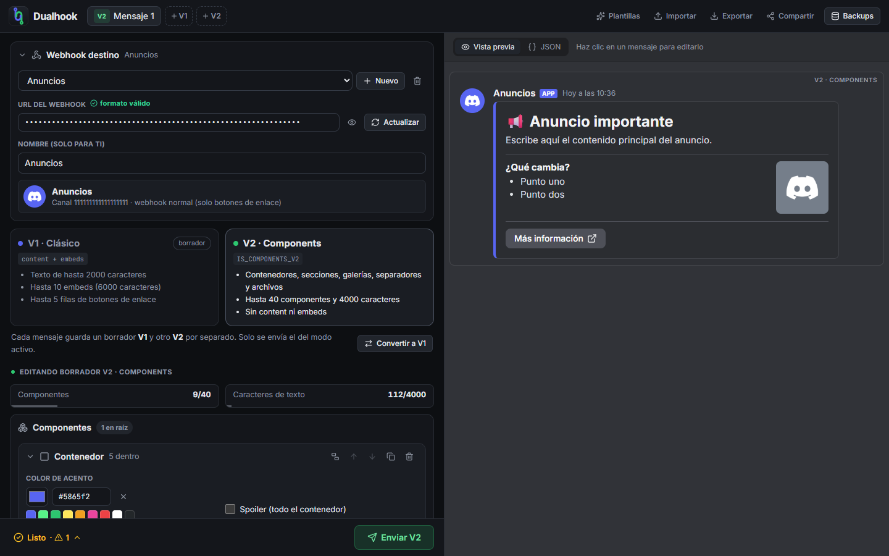
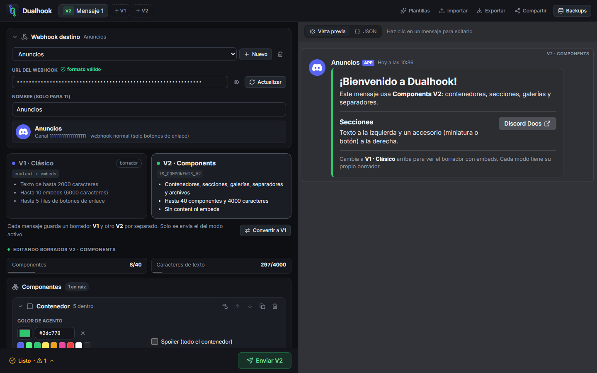
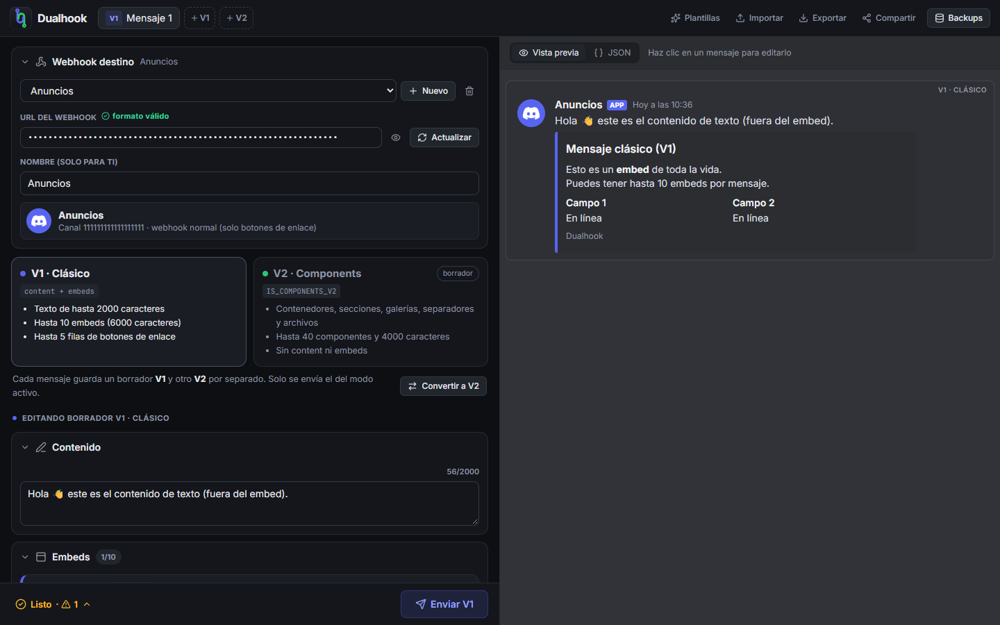
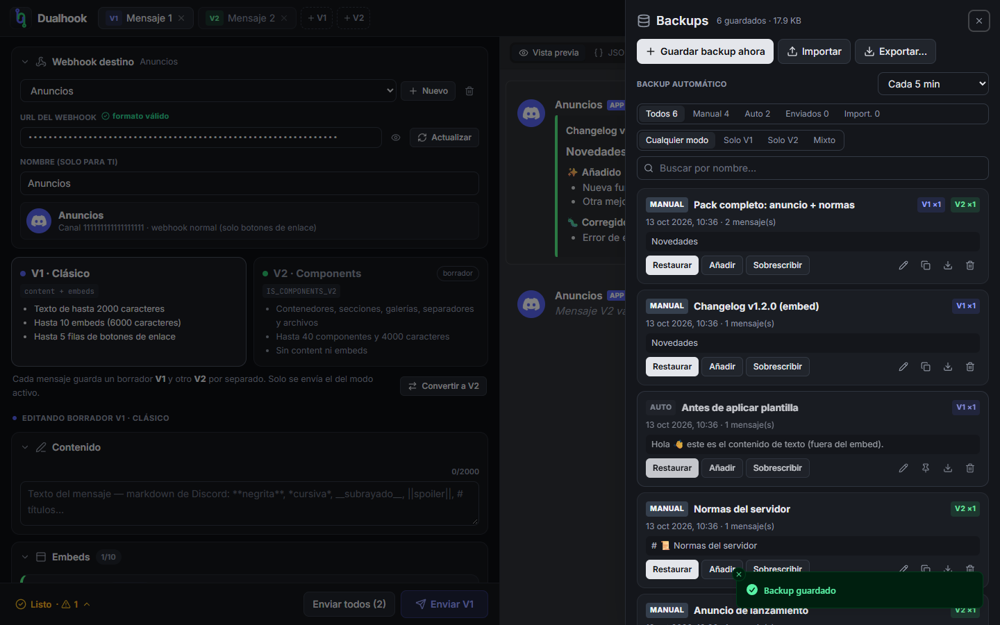
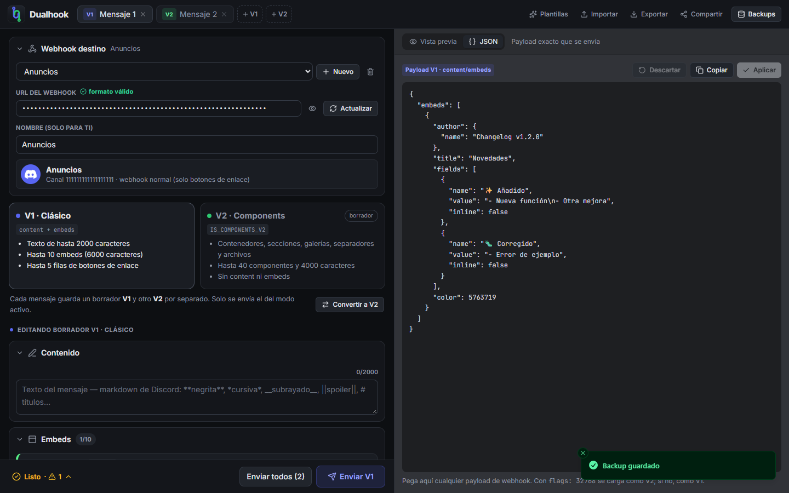
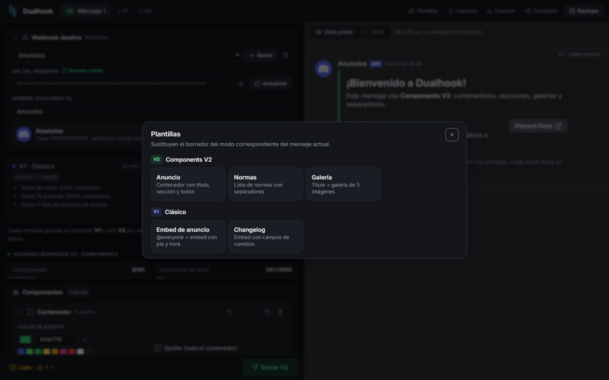
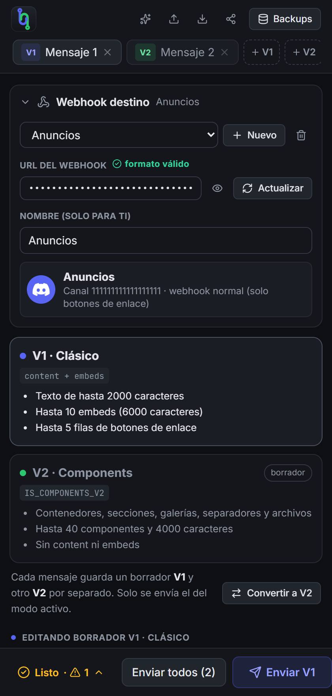

<div align="center">


# Dualhook

**Editor visual de webhooks de Discord, con V1 (embeds) y V2 (Components V2) bien separados y backups de todo.**

**[🚀 Abrir Dualhook](https://zer0.is-a.dev/dualhook/)** · [Guía de uso](#guía-de-uso) · [Changelog](CHANGELOG.md)

[](https://zer0.is-a.dev/dualhook/)
[](https://github.com/Zer0Dev-exe/dualhook/actions/workflows/deploy.yml)
[](CHANGELOG.md)
[](LICENSE)
[](https://react.dev)
[](https://www.typescriptlang.org)
[](https://vitejs.dev)
[](https://tailwindcss.com)
[](https://discord.com/developers/docs/resources/webhook)



</div>

## Índice

- [¿Qué es?](#qué-es)
- [Características](#características)
- [Capturas](#capturas)
- [Empezar](#empezar)
- [Guía de uso](#guía-de-uso)
- [V1 vs V2](#v1-vs-v2)
- [Backups](#backups)
- [Atajos de teclado](#atajos-de-teclado)
- [Privacidad](#privacidad)
- [Stack y versiones](#stack-y-versiones)
- [Estructura del proyecto](#estructura-del-proyecto)
- [Despliegue](#despliegue)
- [Hoja de ruta](#hoja-de-ruta)
- [Changelog](#changelog)
- [Licencia](#licencia)

## ¿Qué es?

**Dual**hook = **dos** formatos de mensaje, **un** editor. Es una alternativa a Discohook para crear, previsualizar, enviar y editar mensajes de
webhooks de Discord. Funciona entero en tu navegador: no hay servidor intermedio y tus datos
(mensajes, webhooks y backups) se quedan en tu equipo.

Está pensado sobre todo para tener **muy clara la diferencia entre los dos formatos de mensaje** que
admite Discord:

| | **V1 · Clásico** | **V2 · Components V2** |
|---|---|---|
| Color en la interfaz | 🟦 Azul | 🟩 Verde |
| Contenido | `content` + `embeds` | Solo `components` |
| Flag | — | `IS_COMPONENTS_V2` (`32768`) |
| Diseño | Texto + tarjetas de embed | Contenedores, secciones, galerías, separadores… |

## Características

### ✏️ Editor

- **Dos borradores por mensaje**: cada mensaje guarda un borrador V1 y otro V2 a la vez. Cambiar de modo
  no borra nada, y solo se envía el del modo activo.
- **Conversión V1 ⇄ V2**: pasa un embed a contenedores V2 (o al revés, de forma aproximada) con un clic.
- **Editor V2 en árbol**: contenedores con color de acento y spoiler, secciones con miniatura o botón,
  galerías de hasta 10 imágenes, archivos, separadores y filas de botones. Puedes meter cualquier
  componente en un contenedor o sacarlo.
- **Editor de embeds completo**: autor, título, URL, descripción, color, hasta 25 campos (en línea o
  no), imagen, miniatura, pie y marca de tiempo.
- **Varios mensajes** (hasta 10) en el mismo espacio de trabajo, con pestañas `+ V1` / `+ V2`.
- **Plantillas** listas para usar: anuncio, normas, galería, changelog…

### 👀 Vista previa y validación

- **Vista previa fiel a Discord** (modo oscuro), con markdown: títulos, `-#` subtexto, listas, citas,
  bloques de código, `||spoilers||`, menciones, emojis personalizados y `<t:…>`.
- **Vista JSON editable** con el payload exacto que se enviará. Puedes pegar uno y aplicarlo.
- **Validación en vivo** con los límites de Discord (caracteres, nº de componentes, URLs obligatorias…),
  con errores y avisos antes de enviar.

### 🚀 Envío

- Enviar uno o **todos los mensajes en orden**.
- **Editar y borrar** mensajes ya enviados (pegando su enlace o ID), o **cargar** uno desde Discord
  para modificarlo.
- Enviar a un **hilo** existente o crear un **post de foro**.
- **Mensajes silenciosos** (`@silent`) y ocultar previsualizaciones de enlaces.
- **Archivos adjuntos** referenciables con `attachment://nombre` en embeds y componentes.
- **Webhooks guardados**, con comprobación de nombre, avatar, canal y si el webhook es de aplicación.

### 💾 Backups y datos

- Backups **manuales, automáticos, de envío e importados**, filtrables por tipo y por modo (V1, V2 o mixto).
- **Importar/exportar JSON**, incluidos backups de **Discohook** y payloads sueltos.
- **Enlaces para compartir** los mensajes, sin incluir el token del webhook.

## Capturas

<table>
  <tr>
    <td width="50%"><p align="center"><b>Modo V2 · Components</b>: árbol de componentes y vista previa</p></td>
    <td width="50%"><p align="center"><b>Modo V1 · Clásico</b>: contenido y embeds, en azul</p></td>
  </tr>
  <tr>
    <td><p align="center"><b>Backups</b> con filtros por tipo y por modo</p></td>
    <td><p align="center"><b>JSON</b>: el payload exacto, editable</p></td>
  </tr>
  <tr>
    <td><p align="center"><b>Plantillas</b> V1 y V2</p></td>
    <td align="center"><p align="center"><b>Responsive</b>: también se usa en el móvil</p></td>
  </tr>
</table>

## Empezar

### Online

No hace falta instalar nada: **[zer0.is-a.dev/dualhook](https://zer0.is-a.dev/dualhook/)**.

### En local

#### Requisitos

- [Node.js](https://nodejs.org) **18 o superior** (probado con Node 24 y npm 11)
- Un navegador moderno (Chrome, Edge, Firefox o Safari recientes)

#### Instalación

```bash
git clone https://github.com/Zer0Dev-exe/dualhook.git
cd dualhook
npm install
```

#### Scripts

| Comando | Qué hace |
|---|---|
| `npm run dev` | Servidor de desarrollo con recarga en vivo en <http://localhost:5173> |
| `npm run build` | Comprueba los tipos y genera `dist/index.html` |
| `npm run preview` | Sirve la build de producción para probarla |
| `npm run typecheck` | Solo comprueba los tipos de TypeScript |

#### Usarlo sin servidor

`npm run build` genera **un único archivo**, `dist/index.html`, con todo incluido (JS, CSS y fuentes).
Puedes abrirlo con doble clic o subirlo a cualquier hosting estático (GitHub Pages, Netlify, Vercel…).

## Guía de uso

1. **Configura el webhook.** En Discord, ve a *Ajustes del canal → Integraciones → Webhooks → Copiar URL*.
   Pégala en **Webhook destino**: su nombre y avatar se cargan solos y se usan en la vista previa.
2. **Elige el modo.** Pulsa la tarjeta **V1 · Clásico** o **V2 · Components**. El color de la interfaz
   cambia para que siempre sepas en qué modo estás.
3. **Construye el mensaje** con el editor (o una plantilla) y revisa la vista previa de la derecha.
4. **Revisa la barra inferior.** Si pone `✓ Listo`, se puede enviar. Si hay errores, haz clic para verlos.
5. **Envía** con el botón o con `Ctrl+Enter`.
6. **¿Quieres cambiar algo?** En **Editar mensaje existente** pulsa *Editar ese mensaje* (o pega el enlace
   de otro mensaje del mismo webhook), modifica el contenido y pulsa **Guardar edición**.

> [!TIP]
> En los campos de imagen puedes escribir `attachment://` para usar un archivo adjunto. Los archivos se
> añaden en **Archivos adjuntos**.

> [!NOTE]
> En un webhook normal Discord solo acepta **botones de enlace**. Los botones de otros estilos (primario,
> éxito…) solo funcionan en webhooks creados por un bot, y es el bot quien gestiona sus pulsaciones.

## V1 vs V2

Límites que Dualhook valida antes de enviar:

| Límite | V1 · Clásico | V2 · Components |
|---|---|---|
| Texto | `content` ≤ 2000 | ≤ 4000 en total entre todos los textos |
| Embeds | ≤ 10, ≤ 6000 caracteres en total | No se permiten |
| Componentes | ≤ 5 filas de botones | ≤ 40 componentes en total |
| Botones por fila | ≤ 5 | ≤ 5 |
| Campos de embed | ≤ 25 (nombre ≤ 256, valor ≤ 1024) | — |
| Galería | — | 1–10 imágenes |
| Textos por sección | — | 1–3 |
| Archivos adjuntos | ≤ 10 | ≤ 10 (deben usarse en algún componente) |

Al **editar** un mensaje, uno V1 se puede convertir a V2, pero uno V2 ya no puede volver a V1.

## Backups

| Tipo | Cuándo se crea | Se conserva |
|---|---|---|
| **Manual** | Botón *Guardar backup ahora* o `Ctrl+S` | Siempre |
| **Auto** | Cada 1/5/15/30 min si hubo cambios, y antes de restaurar, importar, convertir, aplicar plantillas o JSON, o borrar un mensaje | Los 25 más recientes |
| **Enviado** | Cada vez que envías o editas un mensaje | Los 60 más recientes |
| **Importado** | Al importar un JSON con backups | Siempre |

Puedes **fijar** (📌) un backup automático o de envío para que no se borre. Cada backup se puede
restaurar, añadir al espacio actual, sobrescribir, renombrar o descargar.

**Formatos que se pueden importar:**

- Exportaciones de Dualhook (espacio de trabajo, backups y webhooks)
- Backups exportados de Discohook
- Un payload de webhook suelto (`{ "content": …, "embeds": … }` o `{ "flags": 32768, "components": … }`)
- Un array de payloads

## Atajos de teclado

| Atajo | Acción |
|---|---|
| `Ctrl` + `Enter` | Enviar (o guardar la edición de) el mensaje activo |
| `Ctrl` + `S` | Guardar un backup manual |
| `Esc` | Cerrar diálogos y paneles |

## Privacidad

- **Sin servidor propio**: el navegador habla directamente con `discord.com`.
- Todo se guarda en el `localStorage` de tu navegador. Si borras los datos del navegador, pierdes los
  backups que no hayas exportado.
- La **URL del webhook es un secreto** (incluye el token). Se oculta por defecto, no se incluye en los
  enlaces compartidos y solo se exporta si marcas esa opción expresamente.
- Los **archivos adjuntos** solo viven en la sesión actual: no se guardan en backups.

## Stack y versiones

| Paquete | Versión | Para qué |
|---|---|---|
| [React](https://react.dev) | 18.3.1 | Interfaz |
| [TypeScript](https://www.typescriptlang.org) | 5.9.3 | Tipado estricto |
| [Vite](https://vitejs.dev) | 5.4.21 | Dev server y build |
| [vite-plugin-singlefile](https://github.com/richardtallent/vite-plugin-singlefile) | 2.3.3 | Build en un único HTML |
| [Tailwind CSS](https://tailwindcss.com) | 3.4.19 | Estilos |
| [Zustand](https://zustand.docs.pmnd.rs) | 5.0.15 | Estado global persistido |
| [Immer](https://immerjs.github.io/immer/) | 10.2.0 | Actualizaciones inmutables |
| [Radix UI Dialog](https://www.radix-ui.com) | 1.3.1 | Modales y panel lateral accesibles |
| [lucide-react](https://lucide.dev) | 1.56.0 | Iconos |
| [sonner](https://sonner.emilkowal.ski) | 2.0.8 | Notificaciones |
| Inter / JetBrains Mono (Fontsource) | 5.x | Tipografías incluidas en la build |

Usa la **API de Discord v10** (`/webhooks/{id}/{token}`), con `?wait=true` y `?with_components=true`.

## Estructura del proyecto

```
src/
├── lib/                  Lógica pura (sin React)
│   ├── types.ts          Modelo de datos: Message, Embed, componentes V2, Backup…
│   ├── factory.ts        Creadores, límites y flags de Discord
│   ├── payload.ts        Interno ⇄ payload de Discord, conversión V1 ⇄ V2, importación
│   ├── discord.ts        Cliente de la API de webhooks
│   ├── validation.ts     Validación por modo
│   ├── markdown.ts       Markdown estilo Discord
│   └── templates.ts      Plantillas
├── store/                Estado global (Zustand)
│   ├── workspace.ts      Mensajes
│   ├── targets.ts        Webhooks guardados
│   ├── backups.ts        Backups
│   ├── ui.ts             Preferencias y archivos adjuntos (en memoria)
│   ├── dialogs.ts        confirm/prompt con promesas
│   └── actions.ts        Operaciones entre stores (enviar, restaurar, importar…)
└── components/
    ├── ui/               Primitivas: Button, campos, Card, Modal, Sheet
    ├── layout/           TopBar, SendBar, PreviewPanel
    ├── editor/           Webhook, selector de modo, ajustes del mensaje
    │   ├── v1/           Contenido y embeds
    │   ├── v2/           Árbol de Components V2
    │   └── shared/       Botones, filas, controles de lista
    ├── preview/          Render estilo Discord
    └── dialogs/          Backups, exportar, compartir, plantillas
```

## Despliegue

Cada `push` a `main` lanza el workflow [`deploy.yml`](.github/workflows/deploy.yml), que compila la app
y la publica en **GitHub Pages**. Como la build es un único `index.html` sin rutas absolutas, se puede
servir desde cualquier subcarpeta o hosting estático sin cambiar nada.

## Hoja de ruta

Ideas para próximas versiones:

- [ ] Reordenar componentes arrastrando (drag & drop)
- [ ] Menús de selección (select menus) para webhooks de aplicación
- [ ] Modo claro
- [ ] Más plantillas y plantillas propias guardables
- [ ] Encuestas (polls)

## Changelog

El historial de versiones está en [CHANGELOG.md](CHANGELOG.md).

## Licencia

[MIT](LICENSE) © 2026 Zer0Dev-exe

<div align="center">
<sub>Dualhook no está afiliado a Discord Inc. ni a Discohook.</sub>
</div>
